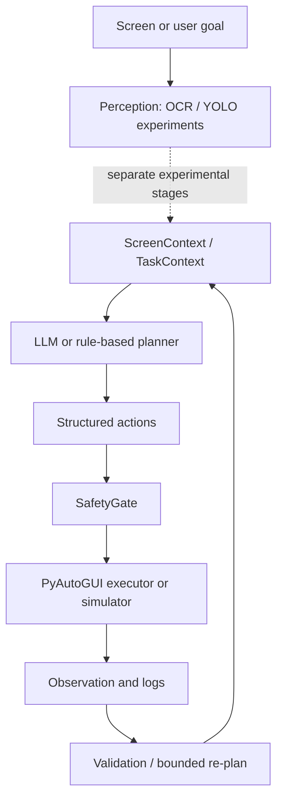

# AI Desktop Agent

A course project exploring desktop AI automation by integrating visual perception, LLM-based planning, safe action execution, and closed-loop task orchestration. The repository preserves four related course experiments. Their code is organized as runnable stages; the final orchestrator does **not** directly load the OCR or YOLO models from earlier stages.

## Project overview and motivation

The project explores how a desktop task can move from screen observation to structured actions and feedback. Experiment 1 creates YOLO text-line labels from EasyOCR detections. Experiment 2 trains a YOLOv8n calculator-control detector on programmatically generated images. Experiment 3 uses an LLM API or rules to plan actions for several controlled scenarios. Experiment 4 adds a task context and bounded orchestration loop. The work was completed for an AI algorithms practice course.

## System architecture and workflow



The dotted link matters: the orchestrator accepts an OCR callback but its default OCR text is a placeholder. Its simulated screenshots and validation support course demonstrations. For a real end-to-end visual pipeline, an OCR callback and model inference must be connected and tested.

## Main components

| Folder | What the code actually does |
|---|---|
| `perception/` | Captures screenshots; EasyOCR boxes are deduplicated and merged into text lines; writes YOLO labels; trains and runs YOLOv8n text-line detection. |
| `visual-control/` | Generates calculator images and labels, trains a YOLOv8n detector, and runs inference. `visual_feedback_automation.py` generates an illustrated feedback demo; it is not a live computer-control recording. |
| `llm-agent/` | Defines `ScreenContext`, JSON actions, rule and API planners, SafetyGate, simulated and PyAutoGUI executors, retries, four scenario examples, and tests. |
| `orchestration/` | Defines `TaskContext`, `ClosedLoopEngine`, a planner, SafetyGate, execution, screenshot capture, validation, logging, and loop/error limits. |

## Perception module

The OCR stage uses EasyOCR to propose text boxes, merges boxes on a line, and converts them to YOLO labels. The calculator detector uses a separate synthetic dataset generator. Both training stages use Ultralytics YOLOv8n. No trained weights or screenshot dataset are included in this repository; the scripts generate data or require user-supplied screenshots.

## LLM agent and safety design

The API planner calls an OpenAI-compatible HTTP/JSON endpoint configured with `OPENAI_BASE_URL`, `OPENAI_API_KEY`, and `OPENAI_MODEL`; a public API option and a rule planner also exist. The model plans structured actions and does not directly drive the mouse. Returned JSON is parsed and checked before execution. `SafetyGate` restricts action types, coordinate ranges, action counts, and selected high-risk words. Real desktop actions require the `REAL_RUN` confirmation argument. These checks are limited course-project safeguards, not a general security boundary.

## Installation and configuration

This project was developed for Windows desktop tasks. Use Python 3.12 if possible, create a virtual environment, then:

```powershell
python -m pip install -r requirements.txt
```

Set API credentials as environment variables. `.env.example` lists the names; the scripts read process environment variables and do **not** automatically load a `.env` file. Never commit a populated `.env`.

## How to run

Run commands from this repository root. The perception scripts use `perception/work` by default. Put screenshots in `perception/work/input_screenshots` before dataset creation. Dataset and training commands overwrite their generated output directories, so keep any results you need elsewhere.

```powershell
python perception/01_截图采集.py
python perception/02_构建文字行级数据集.py
python perception/03_训练文字行检测模型.py
python perception/04_文字行检测推理.py

python visual-control/generate_yolo_dataset.py
python visual-control/train_yolo_model.py
python visual-control/run_trained_yolo_demo.py

python llm-agent/run_demo.py --scenario all --mode simulate
$env:LLM_PROVIDER='rule'
python orchestration/run_experiment.py --scenario all --mode simulate --loops 3
```

For API planning, set the three `OPENAI_*` variables and `LLM_PROVIDER=openai_compatible`. A real desktop mode is available in the two agent stages with `--mode real --confirm REAL_RUN`; use it only after checking the target screen and action sequence. `orchestration/run_real_api_task.py` is a separate controlled file-writing demonstration, not evidence that the OCR/YOLO stages are wired into the orchestrator.

## Example tasks

The LLM agent contains calculator, text extraction, form filling, and batch-task scenarios. The orchestrator contains Notepad and Minesweeper scenarios. Simulated runs use prepared context and generated images. Their logs are demonstrations of the corresponding code paths, not measurements of general desktop reliability.

## Project structure

The four top-level code folders follow the original course stages. `docs/prompt_templates.md` is the retained prompt design note. Generated datasets, screenshots, logs, caches, and model weights are ignored by Git.

## Limitations and future work

The orchestrator's default OCR is a placeholder, the calculator training data are synthetic, and desktop actions depend on screen layout and operating system. The public API option may change or fail. A next step is to connect the existing OCR/YOLO inference functions to the orchestrator callbacks and verify full real-screen runs with a small, anonymized test set. This integration has **not** been claimed as completed here.
